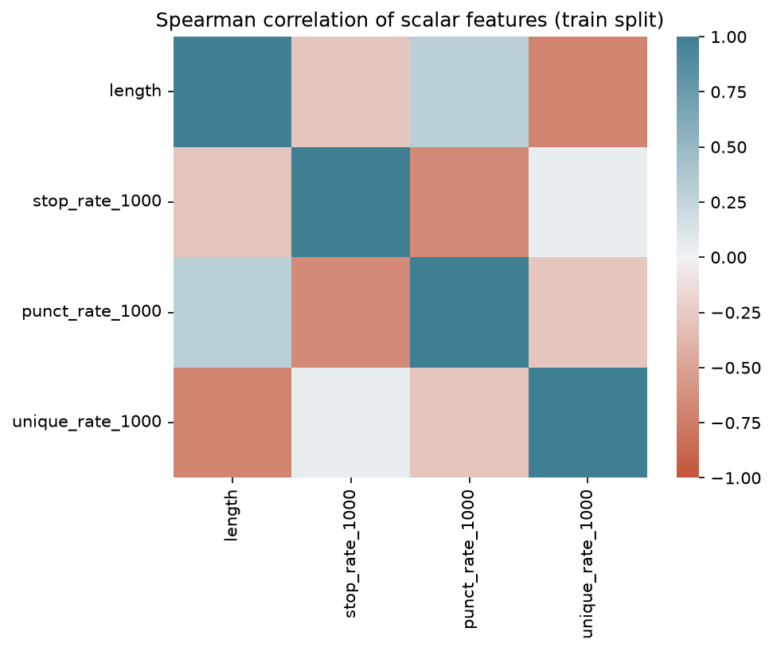

# Federalist Papers: Computational Authorship Attribution

## Project Overview

The Federalist Papers, according to [Encyclopaedia Britannica](https://www.britannica.com/topic/The-Federalist-papers), are a collection of 85 essays published to advocate for the ratification of the proposed Constitution of the United States. All essays were published under the pseudonym *Publius*, concealing the identities of their actual authors.

Although the authorship of most papers has been established, several essays were historically disputed, particularly between Alexander Hamilton and James Madison, who maintained differing claims regarding their respective contributions.

Through historical evidence and computational analysis, scholarly consensus eventually established the following conventional attribution:

| Author | Attributed Papers |
|---|---|
| Alexander Hamilton | 1, 6–9, 11–13, 15–17, 21–36, 59–61, 65–85 |
| James Madison | 10, 14, 37–58, 62–63 |
| John Jay | 2–5, 64 |
| Joint (Madison, with Hamilton)| 18–20 |

Papers 18–20 are attributed as a joint effort between Hamilton and Madison.

This project investigates the use of computational stylometry and supervised machine learning to distinguish between the writing styles of Hamilton and Madison. Mosteller and Wallace’s classic study emphasized the analysis of function words. This project does not reproduce their statistical method or word list. Instead, it tests a stopword-based feature set (spaCy’s stop-word list) against style and topic feature groups through ablation experiments.

The resulting model is subsequently applied to disputed and jointly attributed papers to examine how its predictions compare with established historical scholarship.

## Key findings

1. A feature set built only from spaCy stop words performed as well as any other group: it tied the style group (macro F1 0.947 vs 0.950) and clearly beat topic words (0.738). The selected model, balanced logistic regression, reached macro F1 0.958 ± 0.068 and Madison recall 0.89 in repeated stratified 5-fold CV on 65 essays. Shuffled labels gave 0.48 and document length alone 0.44.
2. Papers 55 and 56 were the two least confident, as in Mosteller and Wallace’s weight-rate study.
3. Caveats: 65 essays, no independent test set, uncalibrated probabilities, and no ground truth for the disputed papers.


## Research Questions & Objectives

### Research Questions

The primary research question is:

> To what extent can computational stylometry distinguish between the writing styles of Alexander Hamilton and James Madison using the accepted Federalist Papers?

The following secondary questions are also explored:

1. How do different groups of stylometric features compare in their ability to distinguish between Hamilton and Madison?
2. How do different classification algorithms and class-weighting strategies affect classification performance?
3. How do the resulting classifications compare with established historical attributions when applied to disputed and jointly attributed papers?

### Objectives

1. Build a leakage-safe pipeline (all fitting inside cross-validation) from spaCy-derived features.
2. Compare feature families (function words, style, topic) and choose one with a rule set and choose one explicit selection rule (see Methodology).
3. Estimate performance with repeated stratified CV, including sanity checks (shuffled labels, length-only).
4. Report probabilities and uncertainty for the disputed and joint essays, not just labels.

## Dataset

The dataset was sourced from [Project Gutenberg's Federalist Papers](https://www.gutenberg.org/ebooks/1404).

The ebook was downloaded in plain-text format and parsed programmatically to extract the individual essays, their paper numbers, author labels, and textual content.

The 85 essays were separated into four categories:

| Category | Number of Papers | Purpose |
|---|---:|---|
| Accepted Papers | 65 | Model development and evaluation |
| Disputed Papers | 12 | Subsequent model inference |
| John Jay's Papers | 5 | Excluded from the primary classification task |
| Joint Papers | 3 | Subsequent model inference |
| **Total** | **85** | |

### Dataset Scope

The primary classification task focuses exclusively on the accepted papers attributed to Hamilton and Madison.

John Jay's papers were excluded because his contribution was limited to five essays, and he was not the primary focus of the Hamilton–Madison authorship dispute.

The accepted papers were labeled as follows:

| Author | Number of Papers |
|---|---:|
| Hamilton | 51 |
| Madison | 14 |
| **Total** | **65** |

The 12 disputed papers (49–58 and 62–63) and three jointly attributed papers (18–20) were excluded from model development and reserved for subsequent inference.

This separation allows the model to learn from papers with established authorship before being applied to documents outside its training dataset.

## Methodology

### 1. Text Preprocessing

Text preprocessing and linguistic feature extraction were performed using [spaCy](https://spacy.io/), an open-source Natural Language Processing library for Python.

The English medium model (`en_core_web_md`) was utilized alongside spaCy's `pipe` functionality to process multiple documents efficiently.

The following preprocessing operations were performed:

| Operation | Description |
|---|---|
| Tokenization | Each paper was treated as an individual document, with its text segmented into tokens. |
| Lowercasing | Tokens were converted to lowercase using `.lower()` to ensure consistent word matching and frequency extraction. |
| Text extraction | Essay bodies were separated from headers, author labels, and concluding references during parsing. |

### 2. Feature Engineering

Features were engineered based on commonly investigated linguistic and stylistic indicators of authorship.

The extracted features were divided into two broad categories: vectorized features and scalar features.

#### Vectorized Features

Vectorized features represent the occurrence and distribution of linguistic elements within a document.

| Feature | Description |
|---|---|
| Stopwords | Extracted tokens identified as stopwords by spaCy. |
| Common Words | Non-stopword and non-punctuation tokens, representing lexical or content-word usage. |
| Parts of Speech (POS) | Grammatical categories assigned to tokens, such as nouns, verbs, adjectives, and adverbs. |
| Character Suffixes | Last 3 characters of tokens, excluding stopwords and punctuation. |
| Noun Chunks | Two-token noun chunks extracted using spaCy's noun chunk functionality. |

These features were converted into numerical representations using `TfidfVectorizer`.

The following configurations were applied:

| Parameter | Value |
|---|---|
| `max_features` | 100 |
| `min_df` | 0.5 |
| `norm` | L2 |
| `lowercase` | False |
| `token_pattern` | None |

The vectorizers use custom analyzers to extract the corresponding linguistic features.

#### Scalar Features

Scalar features represent document-level measurements of linguistic characteristics.

Each measurement was calculated as a rate per 1,000 spaCy tokens.

| Feature | Description |
|---|---|
| Stopword Rate | Number of stopwords divided by the total number of tokens, multiplied by 1,000. |
| Punctuation Rate | Number of punctuation tokens divided by the total number of tokens, multiplied by 1,000. |
| Unique Word Rate | Number of unique alphabetic words divided by the total number of tokens, multiplied by 1,000. |

These measurements provide additional information about the composition of each document beyond individual word frequencies.

### 3. Feature Group Comparison

The engineered features were organized into four groups to investigate their individual and combined contributions to authorship classification.

| Feature Group | Included Features |
|---|---|
| Function Words | Stopword TF-IDF |
| Style | Stopword Rate, Punctuation Rate, Unique Word Rate, Stopword TF-IDF, POS TF-IDF |
| Topic / Lexical Content | Common Word TF-IDF, Noun Chunk TF-IDF |
| All | All eight engineered transformers |

The feature groups were evaluated using Logistic Regression and compared through repeated stratified cross-validation.

Function Words, the smallest group, served as the baseline. Another group would replace it only if its mean macro F1 exceeded Function Words by more than one fold-to-fold standard deviation and its Madison recall was higher. Otherwise, Function Words was kept.

The resulting performance measurements were used to determine which feature group provided the most practical balance between classification performance and feature complexity.

### 4. Model Development & Evaluation

Three classification models were investigated:

| Model | Configuration |
|---|---|
| Logistic Regression | Default class weighting |
| Balanced Logistic Regression | `class_weight='balanced'` |
| Decision Tree | Default configuration |

The vectorized and scalar features were combined using Scikit-learn's `FeatureUnion` and processed through a `StandardScaler` before classification.

#### Cross-Validation Strategy

Repeated Stratified K-Fold cross-validation was used during feature group and model comparisons.

| Parameter | Value |
|---|---|
| Number of folds | 5 |
| Number of repeats | 10 |
| Total fold evaluations | 50 |
| Random state | 42 |
| Stratification | Enabled |

Stratification was used to preserve the relative class distribution across the training and validation folds.

#### Performance Metrics

The following metrics were used to evaluate the models:

- **Macro F1-score:** Measures the unweighted average of each class's F1.
- **F1-score Standard Deviation:** Measures the variability of fold-level F1-scores across repeated validation.
- **Madison Recall:** Measures the proportion of actual Madison papers correctly classified.
- **Madison Precision:** Measures the proportion of papers predicted as Madison that were correctly classified.

A separate shuffled-label experiment and document-length-only baseline were also conducted as sanity checks.

#### Final Model Evaluation

Following feature group and model comparisons, Balanced Logistic Regression using the Function Words feature group was selected as the final model.

Its performance was evaluated using a separate 5-fold Stratified K-Fold cross-validation procedure with out-of-fold predictions.

The resulting predictions were pooled to construct a confusion matrix and calculate aggregate classification metrics.

## Results & Discussion

### 1. Feature Correlation Analysis

Spearman correlation was used to investigate relationships between document length and the scalar stylistic features.

The analysis considered:

- Document Length
- Stopword Rate
- Punctuation Rate
- Unique Word Rate



The observed correlations suggest that some of the scalar features capture overlapping characteristics of document length and composition.

In particular, the relationship between document length and unique-word rate suggests that document size may influence the observed lexical diversity of an essay.

These relationships should be considered when interpreting the scalar features, as correlated measurements may provide partially redundant information.

*Note: The exploratory correlation analysis was performed on the initial stratified training partition of 52 accepted papers.*

### 2. Feature Group Comparison

The following results were obtained using repeated stratified 5-fold cross-validation.

| Feature Group | Mean Macro F1 | F1 SD | Madison Recall | Madison Precision |
|---|---:|---:|---:|---:|
| Function Words | 0.947 | 0.078 | 0.863 | 1.000 |
| Style | 0.950 | 0.077 | 0.870 | 1.000 |
| Topic / Lexical Content | 0.738 | 0.157 | 0.540 | 0.688 |
| All | 0.926 | 0.105 | 0.817 | 0.980 |

The Style feature group achieved the highest mean macro F1-score, closely followed by Function Words.

However, the difference between the two groups was marginal, while the Function Words group contained fewer features.

Consequently, Function Words was selected as the preferred feature group for subsequent model comparisons.

This decision prioritized a simpler feature representation without a substantial observed reduction in classification performance.

The results also suggest that the investigated lexical content and noun chunk features, when used together, were less discriminative than the other feature groups under the current experimental setup.

### 3. Model Comparison

Using the selected Function Words feature group, three classification models were evaluated.

| Model | Mean Macro F1 | F1 SD | Madison Recall | Madison Precision |
|---|---:|---:|---:|---:|
| Logistic Regression | 0.947 | 0.078 | 0.863 | 1.000 |
| Balanced Logistic Regression | 0.958 | 0.068 | 0.890 | 1.000 |
| Decision Tree | 0.892 | 0.091 | 0.853 | 0.860 |

Balanced Logistic Regression had the highest mean macro F1 (0.958 vs 0.947), the lowest SD, and the highest Madison recall (0.890 vs 0.863).

These gaps are smaller than the fold-to-fold standard deviation (about 0.07 to 0.08), so the two logistic regression variants are effectively tied on F1. Madison precision was 1.00 for both, so class weighting did not introduce false Madison calls.

Balanced Logistic Regression was selected because of its higher Madison recall, since Madison is the minority class, and because it assumes an equal prior between the two authors. The Decision Tree scored lower on F1 and precision, and its predicted probabilities are only 0 or 1, so it was not used for inference.

### 4. Baseline and Sanity Checks

Two additional experiments were conducted to investigate whether the classification performance could be explained by random label associations or document length alone.

| Baseline | Mean Macro F1 | F1 SD |
|---|---:|---:|
| Shuffled Labels | 0.482 | 0.099 |
| Document Length Only | 0.441 | 0.044 |

The shuffled-label experiment produced substantially lower performance than the original classification experiments, suggesting that the observed performance was not easily reproduced with randomly reassigned labels.

Similarly, document length alone provided considerably weaker classification performance.

These results provide additional support for the usefulness of the extracted linguistic features, although they do not independently establish the statistical significance of the classification results.

### 5. Final Model Evaluation

The selected Balanced Logistic Regression model was evaluated using a single shuffled 5-fold Stratified K-Fold partition (`random_state=42`), with out-of-fold predictions.

Because this is one partition, its Madison recall (0.86) differs slightly from the repeated-CV mean (0.89).

The pooled out-of-fold confusion matrix was:

| Actual Class | Predicted Hamilton | Predicted Madison |
|---|---:|---:|
| Hamilton | 51 | 0 |
| Madison | 2 | 12 |

The aggregate classification report produced the following results:

| Class | Precision | Recall | F1-score | Support |
|---|---:|---:|---:|---:|
| Hamilton | 0.96 | 1.00 | 0.98 | 51 |
| Madison | 1.00 | 0.86 | 0.92 | 14 |
| **Macro Average** | **0.98** | **0.93** | **0.95** | **65** |
| Weighted Average | 0.97 | 0.97 | 0.97 | 65 |

The model correctly classified all 51 Hamilton papers and 12 of the 14 Madison papers.

Both misclassifications involved Madison papers being classified as Hamilton.

Although the model achieved a high aggregate performance, the difference in class support and the limited number of available documents should be considered when interpreting the results.

### 6. Feature Coefficient Interpretation

The coefficients of the Final Balanced Logistic Regression model fitted on all 65 papers were examined to investigate which stopwords contributed most strongly to the model's classification decisions.

Since the model's class order is Hamilton followed by Madison:

- Negative coefficients indicate an association with Hamilton.
- Positive coefficients indicate an association with Madison.

The following are examples of the strongest coefficients from the fitted model:

| Hamilton-Associated Features | Coefficient | Madison-Associated Features | Coefficient |
|---|---:|---|---:|
| upon | -0.547 | on | +0.607 |
| there | -0.461 | by | +0.488 |
| to | -0.421 | and | +0.363 |
| any | -0.281 | the | +0.313 |
| in | -0.271 | latter | +0.268 |

The coefficients suggest that certain stopwords and their usage patterns provide discriminative information between the two authors within the training dataset.

These coefficients represent associations learned by the classifier rather than definitive or exclusive linguistic characteristics of either author.

### 7. Disputed Papers

After fitting the selected model on all 65 accepted papers, predictions were generated for the 12 disputed papers.

The model's predicted Madison probabilities were interpreted using the following heuristic thresholds:

| Predicted Probability of Madison | Classification |
|---|---|
| Greater than 0.60 | Madison |
| Between 0.40 and 0.60 | Uncertain |
| Less than 0.40 | Hamilton |

The resulting predictions were:

| Paper No. | P(Madison), default LR | P(Madison), balanced LR | Classification (default / balanced) |
|---:|---:|---:|---|
| 49 | 0.885 | 0.943 | Madison / Madison |
| 50 | 0.983 | 0.992 | Madison / Madison |
| 51 | 0.998 | 0.999 | Madison / Madison |
| 52 | 0.946 | 0.974 | Madison / Madison |
| 53 | 0.955 | 0.980 | Madison / Madison |
| 54 | 0.959 | 0.981 | Madison / Madison |
| 55 | 0.379 | 0.547 | Hamilton / Uncertain |
| 56 | 0.802 | 0.896 | Madison / Madison |
| 57 | 0.894 | 0.948 | Madison / Madison |
| 58 | 0.951 | 0.977 | Madison / Madison |
| 62 | 0.915 | 0.960 | Madison / Madison |
| 63 | 0.982 | 0.992 | Madison / Madison |

All disputed papers except Paper 55 were classified as Madison by both models, with predicted probabilities: 0.802 to 0.998 (default) and 0.896 to 0.999 (balanced).

Under default logistic regression, Paper 55 received a Madison probability of 0.379, which the heuristic rule classifies as Hamilton. Under balanced logistic regression it rose to 0.547, which falls in the uncertain range.

Class weighting raised the Madison probability of every disputed paper, because it shifts the model's prior toward an equal split between the two authors. Paper 55 is the only paper close enough to the decision boundary for that shift to change its label. 

In their weight-rate study, Mosteller and Wallace found very strong evidence for Madison in ten of the twelve disputed papers, but described the evidence for Papers 55 and 56 as weak (Mosteller & Wallace, 1964, Section 5.5, Table 5.5-3). In this project, Papers 55 and 56 also received the two lowest Madison probabilities under both class-weighting settings. This agreement in which papers are least certain is consistent with their finding, although the two analyses use different methods and are not directly comparable.

The classification should nevertheless be interpreted as the output of the project's heuristic decision rule rather than a definitive assessment of historical authorship.

### 8. Joint Papers

The same model was applied to the three jointly attributed papers (18–20).

| Paper No. | P(Madison), default LR | P(Madison), balanced LR | Classification (default / balanced) |
|---:|---:|---:|---|
| 18 | 0.993 | 0.997 | Madison / Madison |
| 19 | 0.940 | 0.972 | Madison / Madison |
| 20 | 0.957 | 0.980 | Madison / Madison |

All three papers were classified as Madison under both models with relatively high predicted probabilities.

This suggests that the linguistic characteristics of these papers were closer to the model's learned Madison representation than its Hamilton representation.

However, since the model was trained as a binary classifier, it cannot identify joint authorship or estimate how much each author contributed.

Mosteller and Wallace make a related point: for the joint papers, they describe the problem as "one of extent" (how much each author wrote) rather than one of who wrote them, and give the log odds only "for general interest" (1964, Section 5.5).

The results therefore do not disprove the possibility of collaboration.

## Limitations & Future Improvements

This project primarily investigates relatively basic stylometric features to distinguish between two authors using a limited collection of historical documents.

Although the implemented features produced promising classification results, several limitations remain:

1. **Limited Dataset Size:** The training dataset consists of only 65 accepted papers, which limits the amount of linguistic variation available for model development.

2. **No ground truth for the disputed papers:** The authorship of papers 49–58 and 62–63 is a scholarly conclusion based on historical and statistical evidence, not a known fact. Agreement between this model and that conclusion shows consistency, not proof.

3. **Class Imbalance:** Hamilton and Madison have substantially different numbers of accepted papers in the selected dataset. Class weighting was explored to address this imbalance, but it does not eliminate the underlying limitation.

4. **Feature Limitations:** The project focuses on relatively basic lexical, linguistic, and document-level features. More advanced stylometric features may provide additional discriminative information.

5. **Document Length:** Differences in document length may influence extracted linguistic measurements and word distributions.

6. **Historical Language:** The language and writing conventions of the eighteenth century may introduce characteristics that are not fully captured by the implemented preprocessing and feature extraction methods.

7. **Discarded held-out split:** The same collection of 65 papers was used for feature group comparisons, model comparisons, and final cross-validation. An initial 80/20 split was created, but its 13-essay test set (3 Madison papers) was evaluated on several models, so it was no longer an untouched test set. The project moved to repeated cross-validation on all 65 papers. As a result, there is no independent test set, and the reported performance is a CV estimate that may be optimistic.

8. **Binary Classification:** The final model only distinguishes between Hamilton and Madison. It cannot identify joint authorship or attribute a paper to an author outside these two classes.

9. **Probability Interpretation:** The predicted probabilities have not been independently calibrated and should not be interpreted as actual probabilities of historical authorship. Paper 55's classification also changes with class weighting.
### Future Improvements

Potential improvements include:

- Exploring additional stylometric features, including character n-grams, sentence-level measurements, and syntactic patterns.
- Investigating more advanced feature selection techniques.
- Exploring models capable of identifying potential co-authorship.
- Applying nested cross-validation or an independent evaluation dataset to obtain a less biased estimate of model performance.
- Investigating probability calibration and alternative uncertainty estimation methods.
- Comparing results with additional computational authorship attribution approaches.

## Installation & Usage

### Requirements

- Python 3.14.7 
- Jupyter Notebook or JupyterLab
- spaCy English medium model (`en_core_web_md`)

### Installation

Clone the repository:

```bash
git clone https://github.com/kim44321/federalist-papers/
cd https://github.com/kim44321/federalist-papers/
```

Install the required Python packages:

```bash
pip install -r requirements.txt
```

Download the required spaCy model:

```bash
python -m spacy download en_core_web_md
```

### Dataset Setup

The notebook expects the Federalist Papers text file at:

```text
./data/federalist_papers.txt
```

The original dataset can be obtained from [Project Gutenberg](https://www.gutenberg.org/ebooks/1404).

If the dataset is unavailable, uncomment and execute the dataset acquisition cell in the notebook to download the plain-text version.

Ensure that the `data/` directory exists before downloading the file.

### Running the Notebook

1. Launch Jupyter Notebook or JupyterLab.
2. Open the project notebook.
3. Execute the cells sequentially.
4. If necessary, run the dataset acquisition cell before proceeding with parsing and preprocessing.

## References & Acknowledgements

1. Mosteller, F., & Wallace, D. L. (1964). *Applied Bayesian and Classical Inference*. Springer-Verlag.
2. Stamatatos, E. (2009). A survey of modern authorship attribution methods. *Journal of the American Society for Information Science and Technology, 60*(3), 538–556.
3. Project Gutenberg. *The Federalist Papers*. https://www.gutenberg.org/ebooks/1404
4. Encyclopaedia Britannica. *The Federalist Papers*. https://www.britannica.com/topic/The-Federalist-papers

### Technologies Used

- Python
- spaCy
- Scikit-learn
- Pandas
- NumPy
- Matplotlib
- Seaborn
- Jupyter Notebook

---

**Disclaimer:** This project is an independent computational exploration of authorship attribution. Its classifications are based on patterns learned from the selected training documents and should not be interpreted as conclusive historical evidence of authorship.